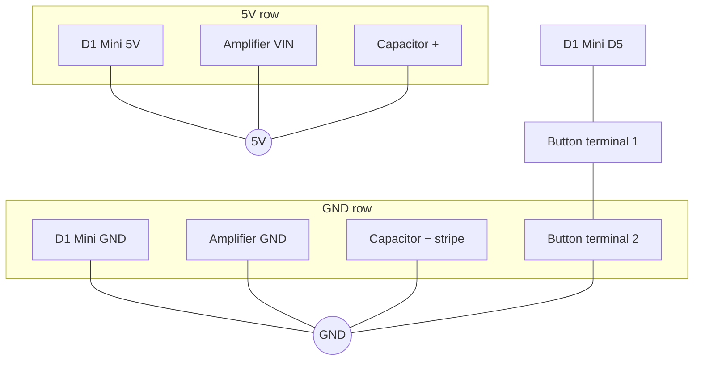
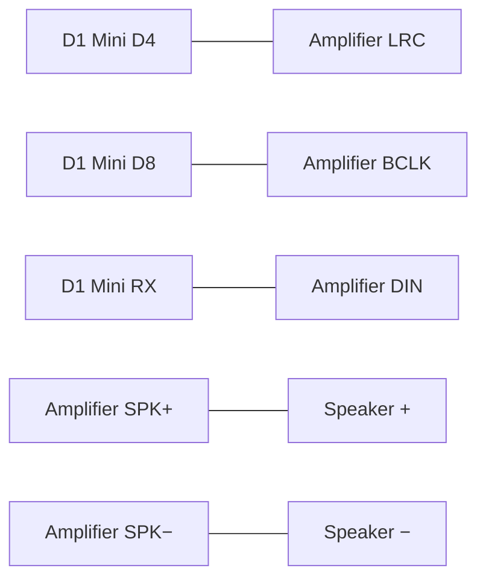

# Connection schema

Wiring for the D1 Mini panic button: button, speaker, both LEDs, and OLED. Pins match `src/config.h` and `src/display_controller.cpp`.

The amplifier, capacitor, and speaker share the **5V** row. The OLED uses **3V3**. Everything shares one **GND** row.

## 5V and GND

These three meet on the 5V row:

- D1 Mini pin **5V**
- Amplifier pin **VIN**
- Capacitor **+** leg (no stripe; usually the longer leg)

These four meet on the GND row:

- D1 Mini pin **GND**
- Amplifier pin **GND**
- Capacitor **−** leg (the side with the stripe)
- Button terminal 2



```text
D1 Mini 5V  ------+------  Amplifier VIN
                  |
                  +------  Capacitor +     (no stripe)

D1 Mini GND ------+------  Amplifier GND
                  |
                  +------  Capacitor −     (stripe)
                  |
                  +------  Button terminal 2
```

The capacitor sits across the amplifier power pins. Both legs connect at the same time: **+** to **VIN**, **−** to **GND**. The striped leg stays on the GND row.

## Amplifier and speaker

```text
D1 Mini D4  -------------  Amplifier LRC
D1 Mini D8  -------------  Amplifier BCLK
D1 Mini RX  -------------  Amplifier DIN

Amplifier SPK+  ---------  Speaker +
Amplifier SPK−  ---------  Speaker −
```



| Amplifier pin | D1 Mini label | GPIO |
| --- | --- | --- |
| LRC (WS, LRCLK) | D4 | GPIO2 |
| BCLK (BCK, SCK) | D8 | GPIO15 |
| DIN (SD) | RX | GPIO3 |
| VIN | 5V | — |
| GND | GND | — |

Leave **GAIN** unconnected. If the board has an **SD** or **SHUTDOWN** pin and the speaker stays silent, tie that pin to **VIN**.

Both speaker wires carry signal. Keep them on **SPK+** and **SPK−**. Swapping them only flips the phase.

## Button

```text
D1 Mini D5  -------------  Button terminal 1
Button terminal 2  ------  GND row
```

Either button terminal can be terminal 1. The firmware uses the internal pull-up on **D5** (GPIO14): released reads high, pressed reads low.

## LEDs

Each LED has its own 220 ohm resistor. The long leg is the anode. The short leg, the side with the flat spot, goes to the GND row.

```text
D1 Mini D7 ---- 220 ohm ---- LED 1 long leg (+)
                              LED 1 short leg (−) ---- GND row

D1 Mini D0 ---- 220 ohm ---- LED 2 long leg (+)
                              LED 2 short leg (−) ---- GND row
```

| LED | D1 Mini label | GPIO |
| --- | --- | --- |
| LED 1 | D7 | GPIO13 |
| LED 2 | D0 | GPIO16 |

During the greeting they take turns: D7 on, D0 on, both on, both off, one step every 200 ms. After the greeting both stay off until a button press, and then they flash together.

## OLED

Match the labels on the OLED board. Pin order differs between modules.

```text
OLED VCC  ----  D1 Mini 3V3
OLED GND  ----  GND row
OLED SCL  ----  D1 Mini D1
OLED SDA  ----  D1 Mini D2
```

| OLED pin | D1 Mini label | GPIO |
| --- | --- | --- |
| VCC | 3V3 | — |
| GND | GND | — |
| SCL | D1 | GPIO5 |
| SDA | D2 | GPIO4 |

**VCC** stays on **3V3**, off the 5V row. On boot the screen shows `HELLO WORLD` and the device name, then `ALL CLEAR`.
